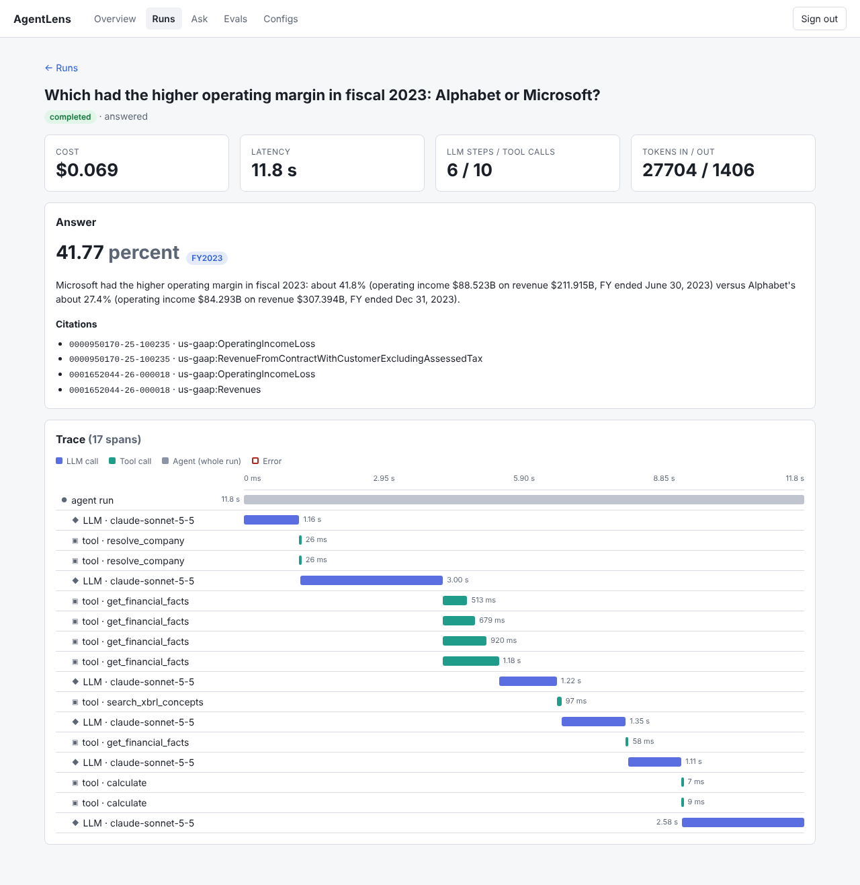
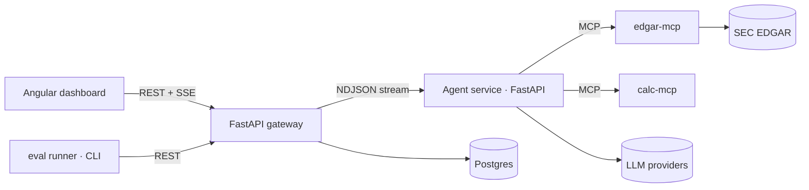

# AgentLens

**Is this LLM agent getting better or worse, and at what cost?** AgentLens is a tool-using research agent over SEC filings,
wrapped in the platform that answers that question: every run is traced, every answer is scored deterministically against a
hand-verified golden set, and every change to a model, prompt or tool is compared with statistics instead of vibes.

> **Status: working, not yet measured.** The agent, gateway, dashboard and eval harness run end to end on live data. The golden
> set is 80 *draft* candidates awaiting hand verification, so **there are no benchmark numbers yet** and none are claimed.
> The results table below is filled from real, verified runs only.


<sub>A real run (live Claude + live SEC data): Alphabet vs Microsoft operating margin, 6 LLM steps and 10 tool calls, $0.069.</sub>

**Replay (real recorded runs, no backend): [shubhp03.github.io/AgentLens](https://shubhp03.github.io/AgentLens/)**. Read-only; individual runs, not benchmark results.

## What's inside
- **Agent** (Python): provider-agnostic tool-calling loop with step and cost budgets, retries and a structured terminal answer
  (`submit_answer`) that carries citations and can abstain.
- **Tools** (MCP servers): read-only SEC EDGAR access (XBRL facts, filings, 10-K sections) and a safe calculator. Filing text is
  treated as untrusted input.
- **Gateway** (FastAPI + PostgreSQL 16): auth, per-key rate limit, daily cost cap, run orchestration, trace persistence, live SSE.
- **Dashboard** (Angular): trace waterfall per run, eval explorer, paired comparison of two configurations.
- **Eval harness**: deterministic scorers, failure taxonomy, repeated trials, Wilson intervals, exact McNemar test, regression
  gate for CI. Runs in-process or through the gateway so results show up in the dashboard.

## Engineering decisions worth a look
- **Contracts are the source of truth.** The gateway's OpenAPI file and the pydantic models are exported to JSON Schema; CI fails on drift.
- **A small, versioned event protocol** separates the stateful gateway from the stateless agent service, so the agent is replaceable in tests.
- **Budgets live inside the loop.** `max_steps` and `max_cost_usd` per run, a daily cap in the gateway, and a hard `--budget-usd` on every eval run. A missing price is a hard error, never a silent $0.
- **Scoring is deterministic: no LLM judge** for numeric, unit, period, abstention and text checks. A case passes when a strict majority of its repeats pass.
- **Gold comes from the source, by a human.** A generator proposes *draft* candidates straight from SEC XBRL with provenance; it cannot emit a verified case. Multi-hop gold is the difference between two companies' figures, so both must be retrieved (a "winner's value" gold lets a model that already knows the winner look up one number). Near-ties are rejected.
- **A no-tools control arm** measures how much of the benchmark is answerable from model memory alone.
- **Tests run on real infrastructure where it matters:** gateway tests use a real PostgreSQL 16, SSE tests use a real socket, and the gateway-mode eval runner is checked to produce records identical to direct mode.

## What running it live turned up
Real bugs and risks found by running against live SEC data and a live model, not by reading code:
1. **Every EDGAR tool call failed behind an HTTP proxy.** The MCP SDK starts stdio servers with a minimal environment, so the tool servers never saw the proxy or CA-bundle variables. Fixed and covered by a test.
2. **A correct answer would have scored wrong.** The model wrote the period as `FY2024 (ended 2024-01-28)` while the scorer matches the label exactly. The scorer stays strict; the field description now asks for a bare label (8 of 8 afterwards, one run each: encouraging, not a measured rate). See [docs/EVAL_DESIGN.md](docs/EVAL_DESIGN.md).
3. **Weak multi-hop questions** (gold equal to a single company's number, or two companies 0.03 points apart) were caught by reading the generated candidates and replaced.
4. **The runner crashed after spending money** on cases with empty gold; gateway mode now refuses them up front, and a run that starts nothing no longer breaks the report.

## Verification status
| Area | Status |
|---|---|
| Offline tests | 223 Python + 22 dashboard unit tests, `ruff` clean, contracts in sync |
| Live LLM + live SEC through the real stack | Verified manually (2026-10-23/24): agent, MCP tools, gateway, Postgres, dashboard |
| CI (GitHub Actions) | First real run 2026-10-24: `python` (lint, format, contracts, 223 tests, stack smoke), `dashboard` (22 tests, build) and `docker` (builds every image, brings the compose stack up on bridge networking, smoke-checks health, migration, dashboard config and agent to MCP) all green. Before that, the workflow was invalid and no job had ever run |
| Docker images | Also built and run by hand (2026-10-24) with a live question answered through containers |
| Recorded runs, cost | 8 real runs, $0.008 to $0.074 each, 1.7 s to 12 s, $0.33 total |
| Golden set | 80 draft candidates generated; **0 verified** (human work in progress) |
| Scored eval results | **None yet** |

## Results (v1.0)
| Config | Pass rate (95% CI) | Cost / successful task | p95 latency | Notes |
|---|---|---|---|---|
| no-tools (control) | _TBD_ | _TBD_ | _TBD_ | How much is answerable from model memory alone? |
| baseline (frontier model + tools) | _TBD_ | _TBD_ | _TBD_ | |
| small model + tools | _TBD_ | _TBD_ | _TBD_ | |

Top failure categories and what fixed them: _TBD, to be written from the first scored run._

## Architecture

Code tour: [docs/CODE_WALKTHROUGH.md](docs/CODE_WALKTHROUGH.md) · Details: [docs/ARCHITECTURE.md](docs/ARCHITECTURE.md) · Eval methodology: [docs/EVAL_DESIGN.md](docs/EVAL_DESIGN.md) · Task list: [docs/REQUIREMENTS.md](docs/REQUIREMENTS.md)

## Quickstart
```bash
make setup && make test                            # Python workspace + offline tests, no network, no spend
make dashboard-demo && make dashboard-serve        # UI on SYNTHETIC data -> http://localhost:4300 (no keys, no spend)
# Real runs (needs ANTHROPIC_API_KEY, SEC_USER_AGENT, config/pricing.yaml from the provider's pricing page):
cp .env.example .env && set -a && source .env && set +a
cp config/pricing.example.yaml config/pricing.yaml  # check the prices against the provider's page
make eval-pilot                                     # up to $2; needs gold on the cases (see docs/RUNNING.md)
```
Full instructions: **[docs/RUNNING.md](docs/RUNNING.md)** (local, gateway mode, golden-set workflow) · **[docs/DEPLOY.md](docs/DEPLOY.md)** (GitHub Pages replay, VM + HTTPS, nightly CI).
Prereqs: Python 3.12, [uv](https://docs.astral.sh/uv/), Node 22.12 or newer, Docker (optional).

## Repo layout
`agent/` agent runtime · `tools/` MCP servers · `evals/` harness + golden set · `gateway/` FastAPI + migrations ·
`dashboard/` Angular · `contracts/` OpenAPI + JSON Schemas · `docs/` design docs · `scripts/` checks + generators

## Limitations (read these)
- The golden set is small (80 candidates, at least 60 needed): differences under roughly 10 points are usually noise; read the intervals.
- Public filings are in model pretraining data; the no-tools control arm quantifies that leakage.
- Fiscal-year labelling and XBRL quirks are a real source of error, tracked as their own failure category. Restated figures and amended filings are not yet represented in the candidate set.
- Not production hardened: single node, in-memory rate limiting, API-key auth only.

## Data and compliance
Public SEC EDGAR data only, accessed under the SEC fair-access policy (declared User-Agent, rate limited, cached).
No employer data, code or systems are used in this project. Not investment advice.
