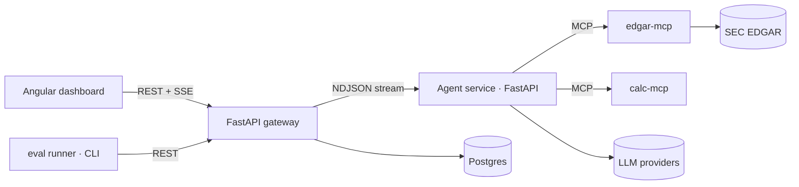

# AgentLens

**Measure whether your LLM agent actually works.** AgentLens is a tool-using research agent over SEC filings,
wrapped in an evaluation and observability platform: every run is traced, every answer is scored against a
hand-verified golden set, and every change to a model, prompt, or tool is compared with statistics instead of vibes.

> Status: 🚧 under construction. Numbers below are filled in from real runs only — never estimated.

## Why this exists
Most agent demos show that an agent *can* answer a question. Production teams need to know *how often it is right,
what it costs, how it fails, and whether last night's prompt change made it worse.* This project is a compact, honest
implementation of that loop: **agent → trace → eval → regression gate**.

## Why this matters
Teams ship LLM agents and then cannot answer: *how often is it right? what does a correct answer cost? how does it fail?
did last night's prompt change make it worse?* AgentLens turns those into numbers: deterministic scoring against a hand-verified
set, a fixed failure taxonomy, repeated trials with confidence intervals, paired significance tests between configurations,
and a CI gate that fails a build on a statistically meaningful regression. The same loop applies to any tool-using agent
(support, research, back-office automation) and is the core of "AI engineering" work in regulated industries such as finance.

## What it does
- **Agent** (Python): provider-agnostic tool-calling loop with step and cost budgets, retries, and a structured
  terminal answer (`submit_answer`) with citations.
- **Tools** (MCP servers): read-only SEC EDGAR access (XBRL facts, filings, sections) and a safe calculator.
- **Gateway** (Python, FastAPI + PostgreSQL): auth, rate limiting, daily cost cap, run orchestration, trace persistence, live SSE.
- **Dashboard** (Angular): trace waterfall per run, eval run explorer, paired model comparison.
- **Evals**: deterministic scorers (numeric/unit/period, citation validity, numeric grounding), failure taxonomy,
  repeated trials, Wilson confidence intervals, exact McNemar test, and a CI regression gate.

## Results (v1.0)
| Config | Pass rate (95% CI) | Cost / successful task | p95 latency | Notes |
|---|---|---|---|---|
| no-tools (control) | _TBD_ | _TBD_ | _TBD_ | How much is answerable from model memory alone? |
| baseline (frontier model + tools) | _TBD_ | _TBD_ | _TBD_ | |
| small model + tools | _TBD_ | _TBD_ | _TBD_ | |

Top failure categories and what fixed them: _TBD — this is the interesting part; write it up._

## Architecture

Code tour: [docs/CODE_WALKTHROUGH.md](docs/CODE_WALKTHROUGH.md) · Details: [docs/ARCHITECTURE.md](docs/ARCHITECTURE.md) · Eval methodology: [docs/EVAL_DESIGN.md](docs/EVAL_DESIGN.md) · Task list: [docs/REQUIREMENTS.md](docs/REQUIREMENTS.md)

## Quickstart
```bash
make setup && make test                            # Python workspace + 205 offline tests
make dashboard-demo && make dashboard-serve        # UI on synthetic data -> http://localhost:4300 (no keys, no spend)
# Real evaluation (needs ANTHROPIC_API_KEY, SEC_USER_AGENT, config/pricing.yaml):
cp .env.example .env && set -a && source .env && set +a
cp config/pricing.example.yaml config/pricing.yaml  # fill from the provider's pricing page
make eval-pilot                                     # up to $2: 3 cases x 1 repeat, writes eval-runs/pilot/report.md
```
Full instructions: **[docs/RUNNING.md](docs/RUNNING.md)** · Deploy (GitHub Pages, VM + HTTPS, nightly CI): **[docs/DEPLOY.md](docs/DEPLOY.md)**.
Full stack: `make up` (Docker; compose validated, images not yet built in the authoring sandbox) or run the gateway directly — see RUNNING.md §4.
Prereqs: Python 3.12, [uv](https://docs.astral.sh/uv/), Node ≥ 22.12, Docker (optional).

## Repo layout
`agent/` agent runtime · `tools/` MCP servers · `evals/` harness + golden set · `gateway/` FastAPI + migrations ·
`dashboard/` Angular · `contracts/` OpenAPI + JSON Schemas · `docs/` design docs · `scripts/` checks + generators

## Limitations (read these)
- Golden set is small (~80 cases): differences under roughly 10 points are usually noise — see the CIs.
- Public filings are in model pretraining data; the no-tools control arm quantifies that leakage.
- Fiscal-year labelling and XBRL quirks are a real source of error; they are tracked as their own failure category.
- Not production hardened: single-node, in-memory rate limiting, API-key auth only.

## Data and compliance
Public SEC EDGAR data only, accessed under the SEC fair-access policy (declared User-Agent, rate limited, cached).
No employer data, code, or systems are used in this project. Not investment advice.
