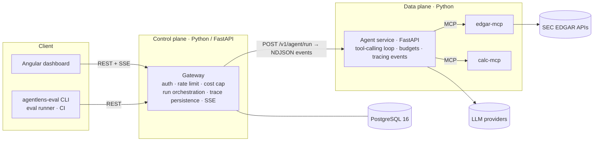
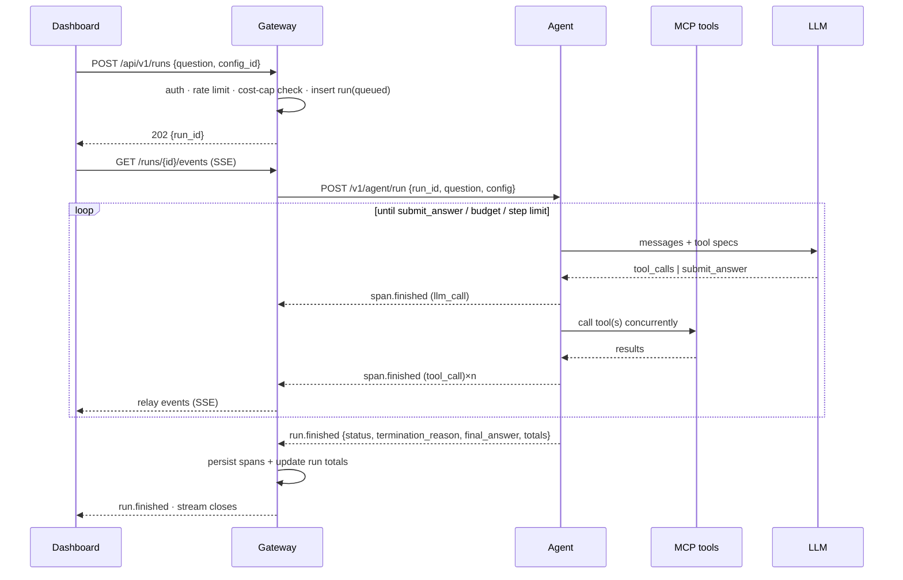
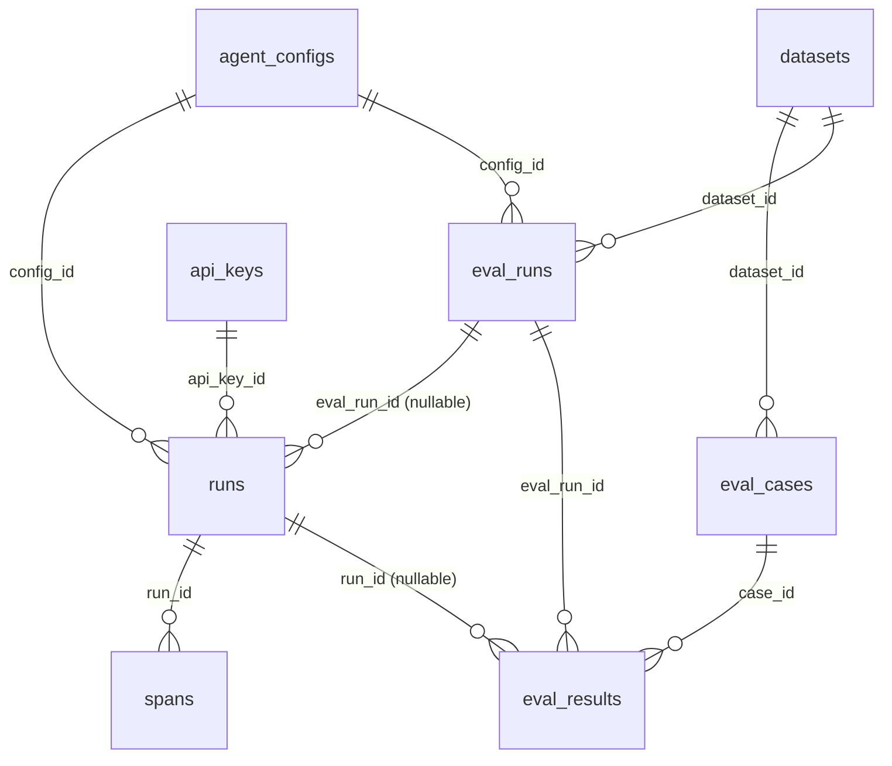

# AgentLens — Architecture

## 1. Purpose and scope
AgentLens answers one question: **"is this agent getting better or worse, and at what cost?"**
It consists of (a) a tool-using agent over public SEC filings, (b) a trace store and dashboard, and (c) an evaluation
harness with statistics and a regression gate. The agent is the *subject under test*; the platform around it is the product.

**Non-goals (v1):** multi-tenant SaaS, fine-grained RBAC, distributed execution, fine-tuning, real-time market data,
side-effecting tools, any employer data.

## 2. System context

**Why split control plane and data plane?** The gateway owns state, identity, spend limits and the public surface. The agent service is stateless, restartable, and
iterates fast in Python where the ML/LLM ecosystem lives. The seam between them is a small, versioned event protocol
(§5), which also makes the agent replaceable in tests.

## 3. Components
| Component | Responsibility | Owns | Explicitly does NOT |
|---|---|---|---|
| **agent** (`agent/`) | Run the loop: call LLM, execute tools, enforce step/cost budgets, emit trace events, return structured answer | In-flight run state only | Persist anything, authenticate users, know about datasets |
| **edgar-mcp** (`tools/`) | Read-only SEC access: resolve company, list filings, search/read XBRL facts, read 10-K sections. Rate-limit + cache | HTTP cache (disk) | Interpret financial meaning; write anything |
| **calc-mcp** (`tools/`) | AST-whitelisted arithmetic (growth, CAGR, ratios) | — | `eval()` anything |
| **gateway** (`gateway/`) | API key auth, per-key rate limit, daily cost cap, run lifecycle, persist spans, SSE fan-out, dataset/eval-run registry, comparison endpoint | Postgres | Call LLMs directly; score answers |
| **eval runner** (`evals/`) | Iterate dataset × config × repeats, score each result, post results, apply the gate | Scorers, statistics | Execute the agent logic itself |
| **dashboard** (`dashboard/`) | Visualize runs/traces/evals/comparisons; playground | — | Hold secrets beyond the API key in memory |

## 4. Key flows
### 4.1 Interactive run

### 4.2 Eval run
> Release A runs the same loop in **direct mode**: the runner calls the agent service itself and writes `results.jsonl` +
> traces to disk (requirement EV-05). Gateway mode (EV-10) is the sequence below.

```mermaid
sequenceDiagram
  participant R as Eval runner
  participant G as Gateway
  R->>G: POST /datasets (idempotent; 409 if content changed under same version)
  R->>G: POST /configs (idempotent)
  R->>G: POST /eval-runs {dataset, config, repeats, git_sha}
  par bounded concurrency (default 4)
    R->>G: POST /runs {source: eval, eval_run_id}
    R->>G: poll GET /runs/{id}?include=spans
    R->>R: score (deterministic scorers) → pass/fail + failure_category
  end
  R->>G: POST /eval-runs/{id}/results (batches)
  R->>G: POST /eval-runs/{id}/complete {status, gate_passed}
  Note over R: --gate: compare to baseline (paired McNemar) + absolute floors → exit code
```

## 5. Agent runtime design
**Loop** (full contract in the `agent/src/agentlens_agent/loop.py` docstring): call LLM → if `submit_answer`, validate and
finish; else execute tool calls concurrently, append results, repeat. Termination is always one of
`answered | step_limit | budget_exceeded | tool_failure | provider_error | timeout | cancelled`.

Design decisions that matter:
- **Terminal tool for the answer.** `submit_answer` carries a pydantic-validated `Answer` (value, unit, period, citations,
  `abstained`). Provider-agnostic structured output, unambiguous "done" signal, abstention as a first-class outcome.
- **Provider-agnostic `LLMClient` protocol.** Adapters translate to/from one neutral message model. The loop never imports a
  vendor SDK. `ScriptedLLM` makes the loop fully testable without network or cost.
- **Budgets enforced inside the loop.** `max_steps` and `max_cost_usd` per run; cost is computed per LLM call from
  `config/pricing.yaml` (missing/zero price = hard error, never a silent $0).
- **Tool errors are data, not crashes.** A tool failure becomes an `is_error` tool result the model can recover from; the
  eval scorer later distinguishes recovered vs unrecovered tool errors.
- **Bounded context.** Tool outputs truncated at 12k chars with a visible marker; large documents are paged (`offset`).
- **Retries only where safe.** Provider 429/5xx/timeouts: ≤3 attempts, exponential backoff + jitter, each attempt its own span.
  Tool calls are not blindly retried.
- **Determinism is limited.** `temperature=0` reduces but does not eliminate variance, hence repeated trials in evals.

### Event protocol (agent → gateway, NDJSON)
One JSON object per line, discriminated by `kind`. Schema: `contracts/agent_events.schema.json` (generated from `agent/.../events.py`).
| kind | Purpose | Notes |
|---|---|---|
| `run.started` | Run began | |
| `span.started` | (P1) in-flight span for live UI | Optional |
| `span.finished` | Completed span: type (`agent`/`llm_call`/`tool_call`), name, input/output, usage, cost, attributes | `span_id` is client-generated ⇒ idempotent upsert; `seq` strictly increasing per run |
| `run.finished` | Terminal event: status, termination_reason, final_answer, totals | Exactly one per run |

The root `agent` span is emitted **last** (it ends last), so the DB deliberately has no FK on `parent_span_id`.

## 6. Tool layer
| Tool | Input (abridged) | Output | Failure modes worth evaluating |
|---|---|---|---|
| `resolve_company` | ticker or name fragment | up to 5 `{cik, ticker, name}` | ambiguous names, share classes |
| `list_filings` | cik, forms, limit | accession, form, filed, period_end, primary_document | picking wrong filing/amendment |
| `search_xbrl_concepts` | cik, keyword | concept names + labels | none found, many near-duplicates |
| `get_financial_facts` | cik, concept, period_type, end_from/to | de-duplicated facts with start/end/value/unit/accession | **fiscal-year labelling**, wrong concept (`Revenues` vs `RevenueFromContract…`), restatements |
| `get_filing_section` | cik, accession, item, primary_document, offset | paged plain text under `untrusted_text` | section extraction misses; long sections |
| `calculate` | expression | `{result}` | argument-comma ambiguity, unit mix-ups |

**Domain gotchas encoded in the tools** (and probed by evals): XBRL `fy`/`fp` describe the *filing*, not the fact's period —
so periods are selected by `start`/`end` dates and duration; the same period appears in several filings — keep the latest
filed; fiscal years end in different months; 10-K HTML has a table of contents that duplicates item headings.

**SEC fair access:** every request carries `SEC_USER_AGENT` (name + email), throttled below 10/s (verify the current policy
text at sec.gov), responses cached on disk (facts 1 day, tickers 7 days, filed documents 1 year).

**Prompt-injection posture.** Filing text is untrusted. It is returned under `untrusted_text`, the system prompt says to treat
it as data, and the agent has **no side-effecting tools** — worst case an injected instruction corrupts one answer, it cannot act.
A small injection test set (EV-14, P2) measures this.

## 7. Data model
Full DDL: `gateway/migrations/V1__init.sql` (verified on PostgreSQL 16 by `scripts/smoke_schema.py`).

Integrity rules enforced in the DB, not just code: `eval_results.passed ⇔ failure_category IS NULL` (every failure is
categorised); a run is terminal ⇔ `finished_at` is set; `(run_id, seq)` unique on spans; at most one baseline eval run per
dataset; configs are immutable snapshots deduplicated by `config_hash`; datasets are versioned with a `content_hash` so silent
gold edits are detected. Views: `eval_run_metrics` (pass rate, cost/success, p50/p95), `daily_spend` (cost cap).

**OpenTelemetry GenAI conventions:** span `attributes` should use the standard `gen_ai.*` names where one exists. Verify against
the current semantic conventions before claiming compliance; an OTLP exporter is a P2 stretch.

## 8. Gateway design (`gateway/src/agentlens_gateway/`)
- **Stack:** FastAPI, async psycopg 3 pool, raw SQL (`store.py`), no ORM. Migrations: forward-only runner with an advisory lock and checksums (`db.py`).
- **Auth:** `X-API-Key` → SHA-256 → `api_keys`. Keys shown once, only hashes stored. Admin key seeded from env; rotating it revokes the old one.
- **Rate limiting:** in-memory token bucket per key on `POST /runs` (single node). *At scale:* Redis-backed buckets.
- **Cost cap:** before dispatch, reject with `429` + `Retry-After` if `spend today + reserved max_cost of in-flight runs ≥ DAILY_COST_CAP_USD`. Protects a public demo from burning money.
- **Execution:** `RunExecutor` = one asyncio task per run, a semaphore for max concurrency, `asyncio.timeout` per run, cancel via task cancellation.
- **SSE:** `RunBus` fan-out with bounded per-subscriber queues; a new subscriber subscribes first, then replays persisted spans (deduped by span id), then streams live: no missed events. 15s keepalive.
- **Crash recovery:** on boot, runs stuck in `queued`/`running` → `failed / gateway_restart`; graceful shutdown does the same for in-flight runs.
- **Errors:** RFC 9457 `problem+json`. **CORS:** allow-list from env (`*` refused). **Observability:** `/healthz`; structured logs with `run_id` (TODO: metrics endpoint).

## 9. Dashboard
Views and components: `dashboard/PLAN.md`. The two screens that carry the project: **run detail with a trace waterfall** and
**eval comparison** (paired outcomes, CIs, regressed/improved cases, cost-vs-quality).

## 10. Deployment
- **Local:** `docker compose up` (Postgres 16, agent, two MCP servers, gateway, dashboard). Compose is validated (`docker compose config`) but images have not been built in the authoring sandbox (no Docker daemon). `make stack-smoke` exercises the same topology over real sockets without Docker.
- **Public demo (recommended shape):** one small VM running compose behind Caddy (automatic TLS), secrets from a secret manager.
  **Do not expose live LLM calls publicly without guardrails.** Default the public site to **replay mode** (recorded runs, no spend);
  live mode requires an API key and is bounded by the daily cap.
- **CI:** PR pipeline = lint + unit tests + contract checks, no live models. Nightly = live eval with `--budget-usd` and the regression gate.

## 11. Security and compliance
Secrets only via env/secret manager; API keys hashed; request validation (question ≤ 2000 chars); SEC User-Agent declared;
dependency versions pinned with a lockfile (pin the `uv` image too); read-only tools; public data only; no employer code/data
(and check your employer's outside-activity/IP policy before publishing — OPS-08).

## 12. Quality targets (NFRs)
| Area | Target (v1) |
|---|---|
| Gateway overhead (excl. agent) | p95 < 50 ms for non-streaming endpoints on the demo VM |
| Trace durability | No lost spans on gateway restart for completed runs; idempotent replay |
| Cost control | Hard per-run budget + daily cap; unit-tested |
| Reproducibility | Every eval result links to config hash, prompt sha, dataset content hash, git sha |
| Test coverage | Python core logic + scorers high; gateway services + persistence integration-tested; CI green on every PR |

## 13. Decision log (ADR-lite)
| # | Decision | Why | Alternative rejected |
|---|---|---|---|
| 1 | Custom thin agent loop, not a framework | Interview-defensible; full control of budgets/tracing; fewer moving parts | LangGraph/LangChain (hides the thing being evaluated) |
| 2 | Terminal `submit_answer` tool | Structured, provider-agnostic output; abstention explicit | Parse JSON from free text |
| 3 | MCP for tools | Standard protocol, clean process boundary, resume-relevant | In-process function calls |
| 4 | Agent stateless; gateway owns persistence | Restartable agent; one place for state/limits | Agent writes to DB directly |
| 5 | Eval runner via gateway (v1.0); **direct mode** for Release A | Uniform traces once the gateway exists; direct mode (`results.jsonl`) lets results ship before the UI does | Direct mode forever |
| 6 | Deterministic scorers first; LLM judge only for free text | Auditable, cheap, no judge drift | Judge everything |
| 7 | CHECK constraints over PG enums | Easier migrations | Native enums |
| 8 | Config hash computed only in gateway | Avoid cross-language canonical-JSON drift | Hash in both |
| 9 | Replay-mode public demo | Prevents cost abuse | Open live endpoint |
| 10 | `mcp` SDK pinned `>=2,<3` | v2 renamed `FastMCP`→`MCPServer` and changed APIs; avoids stale v1 snippets | Stay on v1 |
| 11 | No FK on `spans.parent_span_id` | Root span is emitted last; FK would force ordering hacks | Deferred FK |

## 14. "What I'd do at scale" (interview talking points)
Redis-backed rate limiting and a durable job queue (SQS/Kafka) between gateway and agent workers; autoscaled stateless agent pool;
partitioned `spans` table + cold storage of old payloads; OTLP export to a standard observability backend; OIDC + per-tenant
isolation; dataset versioning with review workflow; judge calibration with human labels; canary comparisons on live traffic.

## 15. Repo layout
```
agentlens/
├── README.md  AGENTS.md  Makefile  docker-compose.yml  pyproject.toml (uv workspace)  .env.example
├── agent/        src/agentlens_agent/{events,answer,config,cost,registry,loop,mcp_registry,wiring,main,llm/}  prompts/  tests/
├── tools/        src/agentlens_tools/{calc,edgar_parse,edgar_client,edgar_server,_run}  tests/
├── evals/        src/agentlens_evals/{case,stats,compare,cli,scorers/}  datasets/golden_v0.jsonl  tests/
├── gateway/      src/agentlens_gateway/{app,settings,store,executor,bus,routes/,...}  migrations/V1,V2  tests/ (real Postgres)
├── dashboard/    Angular 21 (built) · PLAN.md
├── contracts/    openapi.yaml · agent_events.schema.json · eval_case.schema.json
├── config/       agents/*.yaml · pricing.example.yaml
├── docs/         ARCHITECTURE · REQUIREMENTS · EVAL_DESIGN · BUILD_PLAN
├── scripts/      bootstrap_dashboard.sh · gen_demo_data.py · stack_smoke.py · ui_smoke.py · export_schemas.py · validate_contracts.py · smoke_schema.py
└── .github/workflows/  ci.yml · nightly-eval.yml
```


## Decision record: gateway language (decided: Python)

**Decision:** the gateway is Python (FastAPI + psycopg 3), one language end to end.

**History, recorded honestly.** The first version of this repo specified a Spring Boot gateway for resume signal. The design
doc then admitted nothing in the gateway needs the JVM, and the owner chose Python: the owner already has deep Java/Spring
experience at work, and wants Python depth for AI/ML roles and coding-interview fluency. The Java gateway was never completed
(only pure logic and a Maven skeleton existed, never built in the authoring sandbox because Maven Central was blocked) and was
removed. The contract, schema and dashboard were unchanged by the switch; that is the point of contract-first.

**Consequences:** one toolchain and one image; the gateway reuses the agent's event models and the evals package's statistics
directly (no parity vectors, no cross-language drift); rate limiting is a small hand-rolled token bucket instead of Bucket4j.
**Trade-off accepted:** a single-process asyncio gateway; scaling out needs the items in §14 (shared rate-limit state, a job queue).
